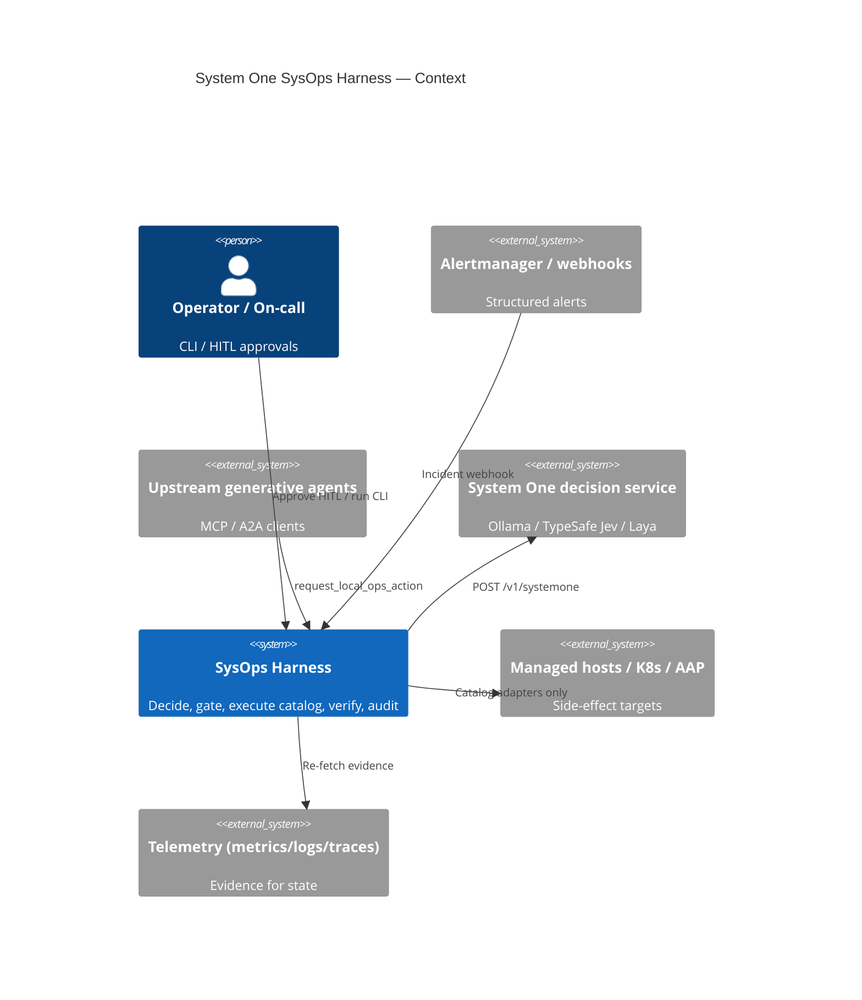
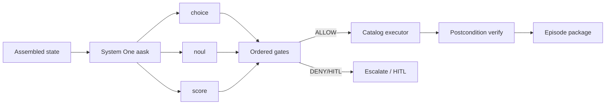
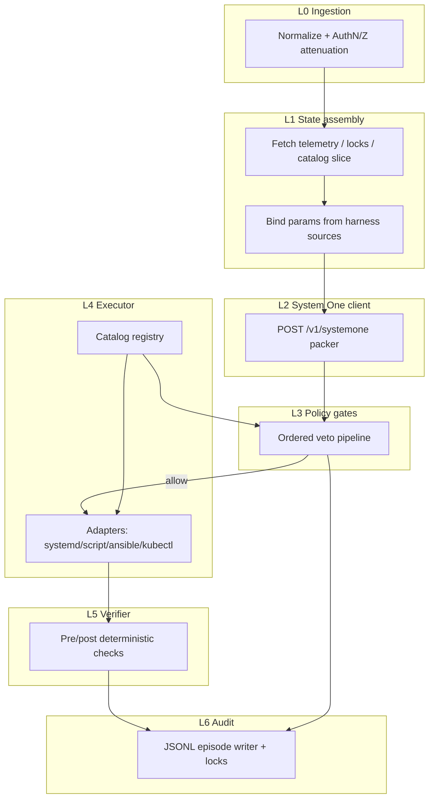
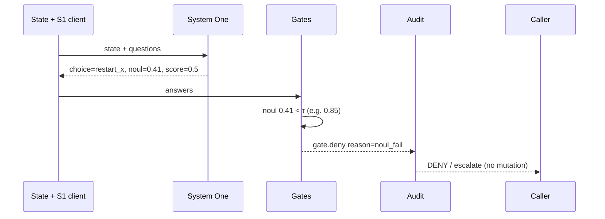
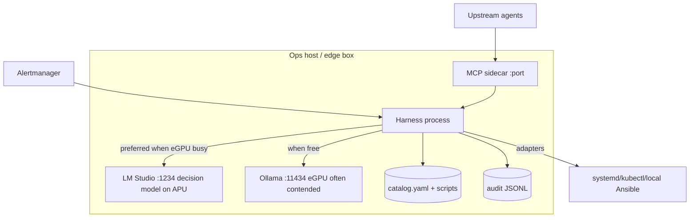

# SysOne SysOps Harness — arc42 Architecture

**Version:** 0.1 (research design)  
**Status:** implementable blueprint; no production binary in-repo  
**Sources:** `notes/harness_architecture.md`, `notes/harness_implementation.md`, `notes/extensive_research.md`, `research_articles/sysone_ops_harness.md`

---

## 1. Introduction and Goals

### 1.1 Requirements overview

Build a **local-first SysOps remediation controller** that:

1. Accepts structured incident requests from monitoring webhooks, operators, or untrusted upstream generative agents (MCP).
2. Asks a System One decision service typed questions over a shared evidence `state`.
3. Mutates systems **only** by executing engineer-authored catalog playbooks after deterministic policy gates pass.
4. Verifies postconditions and emits append-only audit / episode packages.

### 1.2 Quality goals

| Priority | Quality goal | Rationale |
| --- | --- | --- |
| 1 | **Safety (fail-closed)** | Zero unauthorized argv; false-permit ≪ false-deny; noul/score/HITL vetoes |
| 2 | **Auditability** | Every decide→gate→act→verify cycle reconstructible from JSONL episode package |
| 3 | **Decision latency** | Pack choice+noul+score in one `/v1/systemone` call; local path p50 target for decision hop |
| 4 | **Bounded authority** | Upstream callers attenuated; catalog membership is hard policy |
| 5 | **Operability** | Dry-run default; write kill-switch; locks/cooldowns; clear escalate path |

`TODO(eval):` quantify false-permit rate and decision latency p50/p95 on a held-out ops suite — see [evaluation.md](./evaluation.md).

### 1.3 Stakeholders

| Stakeholder | Interest |
| --- | --- |
| On-call / SRE | Safe auto-remediation with HITL escape |
| Platform / security | No model-authored shell; MCP boundary; audit |
| ML / decision-model owners | Calibrated thresholds; DecideBench-compatible eval |
| Upstream agent builders | Single high-level tool, not bash |
| Researchers | Reproducible episode packages |

---

## 2. Constraints

| ID | Constraint |
| --- | --- |
| C1 | Prefer **local inference** (Ollama Tev/nimble, Laya) when air-gapped; hosted Jev allowed when outbound OK |
| C2 | **No model-authored shell / argv** — executor renders templates from catalog + harness-bound params only |
| C3 | **Catalog-only mutation** — action space \(\mathcal{C} \cup \{\texttt{escalate}\}\) |
| C4 | Params from **state / CMDB / alert fields**, never from free-form model strings |
| C5 | System One `confidence` is **concentration**, not calibrated accuracy — thresholds need empirical fit |
| C6 | Local encoder catalogs stay **≲ ~20** options (Laya token-budget cliff) |
| C7 | Writes default **off**; dry-run default **on** (AAP MCP / keep-mcp pattern) |
| C8 | Telemetry treated as **untrusted** (possible injection) |
| C9 | v1 research scope: architecture + eval protocol; not a shipped production binary |

---

## 3. Context and Scope

### 3.1 Business context

SysOps remediations today either (a) open shell agency (unsafe / weak on chained tools) or (b) fully manual. This system occupies the middle: **typed decisions + catalog side effects**.

### 3.2 Technical context



### 3.3 External actors

| Actor | Trust | Interface |
| --- | --- | --- |
| Alertmanager / monitoring webhooks | Semi-trusted automation | Structured JSON (alert_id, labels, annotations) |
| Upstream generative agents | **Untrusted** | MCP tool `request_local_ops_action(alert_id, …)` — no bash tools |
| Operators | Trusted local | CLI + HITL challenge responses |
| System One service | Semi-trusted (returns distributions only) | `POST /v1/systemone` |
| Executor backends | Trusted adapters | systemd / script / Ansible job template / kubectl templates |

### 3.4 Out of scope (v1)

- Fine-tuning Tev/Laya on private catalogs  
- Live production remediations  
- Optimizing Terminal-Bench open-shell scores  
- Generative RCA / multi-hop tool chaining inside the decision model  

---

## 4. Solution Strategy

1. **Parallel typed decisions:** one System One request packs `choice` (playbook), `noul` (safe to act), `score` (blast radius) over one `state` read — near-zero incremental latency for safety questions (Semantic Router latency table).
2. **Harness-only side effects:** gates interpret answers; executor never sees model-authored strings as argv.
3. **Always-on escalate:** catalog includes `escalate` / OOD option; fail closed on parse/lock/noul/confidence/score band failures.
4. **Host-authorized pattern (Agentao):** proposals (here: distributions) ≠ execution; permissions and write flags are runtime policy.
5. **H3 verification (AI Harness Engineering):** deterministic pre/post checks + episode packages, not NL “looks healthy.”
6. **Attenuated caller surface:** MCP exposes one high-level mutate request; AAP-style dual write gate (server flag + RBAC).



---

## 5. Building Block View

### 5.1 Whitebox overall system



### 5.2 Building blocks

| Block | Responsibility | Key interfaces |
| --- | --- | --- |
| **Ingestion** | Accept webhook/CLI/MCP; reject raw commands; attenuate capability | `Request{alert_id, service_id, op_id, …}` |
| **State assembly** | Re-fetch evidence; build `state`; bind params via JSON Schema | `state: object`, `bound_params` |
| **System One client** | Pack questions; call backend; parse answers | See `notes/harness_implementation.md` |
| **Policy gates** | Ordered vetoes → ALLOW / DENY / HITL / DRY_RUN | Gate decision + reason codes |
| **Catalog** | Playbook IDs, criteria text, risk tiers, locks, executors, checks | YAML/JSON + `catalog_hash` |
| **Executor adapters** | Render template + run; never interpolate model argv | `execute(id, params) → Observation` |
| **Verifier** | Deterministic pre/post conditions | pass/fail + check ids |
| **Audit** | Append-only events; lock/cooldown store | `sysone_ops.audit.v1` JSONL |

**Implementation pointer (research prototype):** layers L0–L6 map to the installable package under [`src/sysone_ops/`](../../src/sysone_ops/) (`ingest`, `state`, `systemone`, `gates`, `catalog` + `executor`, `verify`, `audit`, `cli`). Default catalog prefers [`datasets/sysops_decide/catalog.yaml`](../../datasets/sysops_decide/catalog.yaml). This is a dry-run-first research harness—not a production MCP server.

### 5.3 Catalog entry (sketch)

See implementation notes for full YAML. Minimal fields: `id`, `criteria`, `risk_tier`, `lock_key`, `cooldown_seconds`, `params_schema`, `prechecks`, `executor`, `postchecks`, `confidence_min`, `noul_min`, `auto_max_blast`, `require_hitl_above`.

---

## 6. Runtime View

### 6.1 Happy path

```mermaid
sequenceDiagram
  autonumber
  participant C as Caller
  participant I as Ingestion
  participant S as State assembly
  participant M as System One
  participant G as Gates
  participant E as Executor
  participant V as Verifier
  participant A as Audit

  C->>I: structured request(op_id, alert_id)
  I->>I: authZ; reject raw commands
  I->>S: normalized request
  S->>S: fetch telemetry, catalog, locks; bind params
  S->>M: state + {choice,noul,score}
  M-->>S: answers + distributions
  S->>G: answers + bound_params
  G->>G: ordered vetoes pass
  G->>E: execute(playbook_id, bound_params)
  E-->>V: Observation
  V->>V: postchecks OK
  V-->>A: episode.complete ALLOW
  A-->>C: summary (no secrets)
```

### 6.2 Noul veto



### 6.3 Low-confidence HITL

```mermaid
sequenceDiagram
  participant G as Gates
  participant H as HITL channel
  participant E as Executor
  participant A as Audit

  G->>G: noul OK; choice confidence 0.72 < 0.90
  G-->>H: hitl.challenge (playbook, evidence digest, scores)
  alt operator approves
    H->>E: execute under operator principal
    E-->>A: episode.complete ALLOW_HITL
  else operator rejects / timeout
    H-->>A: episode.complete DENY_HITL
  end
```

### 6.4 Postcondition failure

```mermaid
sequenceDiagram
  participant E as Executor
  participant V as Verifier
  participant A as Audit
  participant C as Caller

  E-->>V: Observation ok=true exit=0
  V->>V: healthz expect 200 → fail
  V-->>A: verify.fail checks=[health]
  Note over A: Do NOT invent fix via model shell
  A-->>C: FAILED_VERIFY; optional re-decide with updated state only
```

### 6.5 Untrusted upstream agent (authority attenuation)

```mermaid
sequenceDiagram
  participant UA as Upstream LLM
  participant MCP as MCP tool
  participant H as Harness
  participant M as System One

  UA->>MCP: "restart nginx on web-02"
  Note over MCP,H: Free text is not authority
  MCP->>H: request_local_ops_action(alert_id=…)
  H->>H: re-fetch host facts; catalog candidates
  H->>M: choice/noul/score
  M-->>H: distributions
  H-->>UA: ALLOW summary or escalate (never raw shell tool)
```

---

## 7. Deployment View

### 7.1 Local-first (air-gapped)



**Lab hardware note:** Ollama on the **eGPU** may run a separate non-decision model. Prefer **LM Studio on the AMD APU** (~8 GB dedicated) for System One once a decision model is loaded (`POST /v1/systemone`). CLI: `--backend lmstudio --model <decision-id>`. See [`notes/local_inference_backends.md`](../../notes/local_inference_backends.md).

### 7.2 Hosted Jev path

- Harness → `https://api.typesafe.ai/v1/systemone` with pinned `jev-x.y.z`.
- Outbound TLS required; pin model version in audit.
- Same gates/executor; only L2 client base URL changes.

### 7.3 Hybrid / MCP sidecar

| Component | Role |
| --- | --- |
| LM Studio (APU) | Local decision model via `/v1/systemone` (Jev-compatible); preferred when eGPU is busy |
| Ollama / llama.cpp | Local System One scoring on eGPU when capacity is free |
| Laya | Ultra-low-latency encoder after domain fine-tune; catalog ≲20 |
| MCP sidecar | Expose one tool; writes off unless `ALLOW_WRITE_OPERATIONS`-style flag |
| Optional AAP | Launch job templates remotely; credentials stay on AAP |

`TODO(eval):` measure cold-start vs warm p50 for LM Studio APU decision model vs Ollama Tev when eGPU is free.

---

## 8. Crosscutting Concepts

### 8.1 Calibration

- Treat System One `confidence` as ranking/concentration signal.
- Fit temperature / thresholds on held-out incidents; track **ECE**, Brier, per-label precision.
- Maintain HITL list for low-precision labels (choy.in hybrid routing pattern).

### 8.2 Locks / idempotency

- Every mutate playbook: `lock_key`, `op_id`, `cooldown_seconds`.
- Acquire lock before execute; release per policy after verify (even on failure).
- Deduplicate retries by `op_id`.

### 8.3 PII / telemetry scrubbing

- Prefer evidence **references** (alert_id, metric name) over raw log dumps in `state`.
- Scrub secrets, tokens, private keys before state assembly.
- Optional injection-span filter inspired by Constrained-Action input rails (generative path); System One path still needs data hygiene.

### 8.4 Observability

- Emit: `decide.start`, `gate.deny`, `hitl.challenge`, `exec.start`, `verify.fail`, `episode.complete`.
- Include `harness_version`, `catalog_hash`, `model`, `caller.surface`, digests — not full secrets.
- Align with AI Harness Engineering episode package concept (H3).

### 8.5 Domain / UI

- Operator HITL UX: show playbook id, criteria match rationale (criteria text), noul/score/confidence, evidence digest, approve/deny.
- No generative “chat to invent a fix” in the mutate path.

---

## 9. Architecture Decisions

Lite ADRs live in [adrs/](./adrs/). Summary:

| ADR | Decision |
| --- | --- |
| [001](./adrs/001-system-one-vs-generative-tool-calling.md) | System One typed decisions over generative tool-calling for mutate selection |
| [002](./adrs/002-catalog-size-local-encoders.md) | Catalog ~20 for local encoders; escalate always present |
| [003](./adrs/003-params-from-state.md) | Params from harness state/CMDB only |
| [004](./adrs/004-untrusted-upstream-callers.md) | Upstream agents untrusted; attenuated MCP surface |

---

## 10. Quality Requirements

Scenarios (see also [evaluation.md](./evaluation.md)):

| ID | Scenario | Target (design) |
| --- | --- | --- |
| Q1 | False-permit on unsafe twin / injection state | Approach **0** under gate policy |
| Q2 | False-deny / HITL rate on safe remediations | Measured; tune τ — accept higher than false-permit |
| Q3 | Decision latency p50/p95 (local Tev / Laya / Jev) | `TODO(eval):` record on reference HW |
| Q4 | Audit completeness | 100% episodes have decide+gate+result fields |
| Q5 | Unauthorized argv | **0** by construction (static + runtime asserts) |
| Q6 | Postcondition-detected failed remediation | Mark FAILED_VERIFY; no silent success |

---

## 11. Risks and Technical Debt

| Risk / debt | Mitigation |
| --- | --- |
| Tev is AR choice SFT, not native non-AR System One | Prefer Ollama `/v1/systemone` scoring; calibrate noul/score empirically |
| Laya weak zero-shot / DecideBench v2 ~39% | Domain fine-tune; keep catalog small; Chain to Jev |
| Confidence uncalibrated | Held-out ECE; per-label HITL tables |
| keep-mcp mutate semantics unfinished | Treat as pattern only; implement own write flags |
| Catalog drift / stale criteria | Version catalog_hash; review cadence |
| Injection in logs biasing choice | Evidence IDs + scrubbing; adversarial eval suite |
| Cascading confidence with upstream agents | Do not multiply scores; re-fetch; decision-type authority (VAOM) |
| Open-shell benchmarks misused as goal | Explicit contrast-only in eval doc |
| MTTR anecdotes cited as science | Forbidden; use SREGym/AIOpsLab proxies later |

---

## 12. Glossary

| Term | Definition |
| --- | --- |
| **System One** | Non-chat typed decision API (`choice`/`noul`/`score`) over shared `state` |
| **choice** | Multi-option selection with probabilities + confidence |
| **noul** | Bernoulli yes-probability in [0,1] |
| **score** | Ordered scale; probability-weighted mean of indices |
| **Catalog** | Finite set of engineer-authored playbooks |
| **Harness** | Deterministic controller: state, gates, execute, verify, audit |
| **ACI** | Agent–Computer Interface (bounded tool/observation surface) |
| **Episode package** | Auditable record of one remediation attempt |
| **False-permit** | Allowing an unsafe / wrong mutate |
| **False-deny** | Blocking a safe / correct mutate (often → HITL) |
| **HITL** | Human-in-the-loop approval band |
| **Authority attenuation** | Reducing caller capability so free text cannot grant mutate rights |
| **Delegation laundering** | Routing a blocked decision through a looser agent (VAOM anti-pattern) |
| **ECE** | Expected Calibration Error |
| **DecideBench** | Public decision-model benchmark — **version-pin v1 vs v2** |
