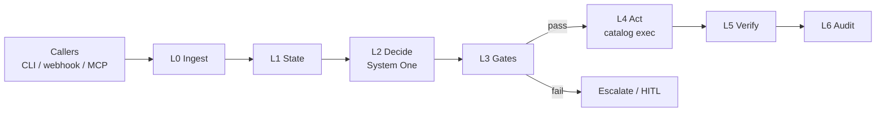
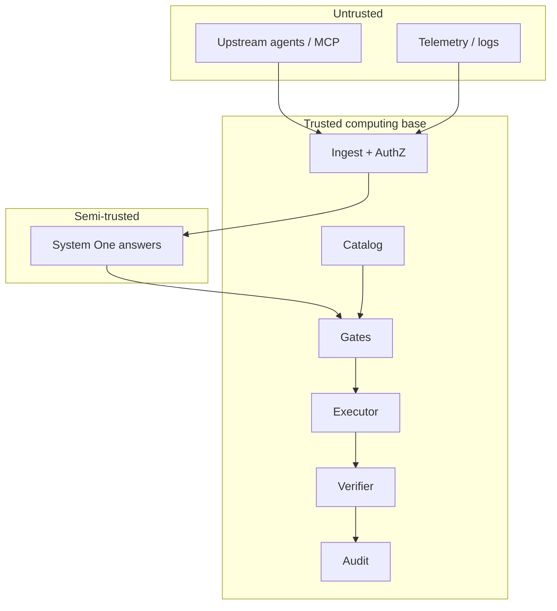
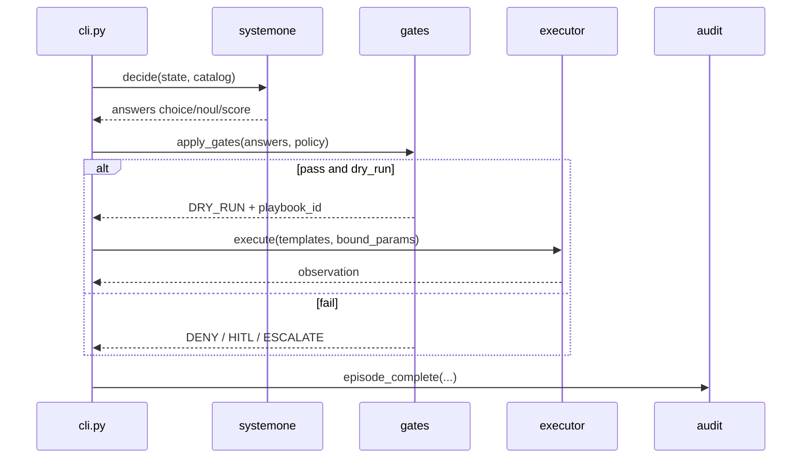

# Escalane harness architecture

**Product:** Escalane = **Decide** + **Act** (vs Agent = LLM + tools)  
**Implementation:** `escalane` (`src/escalane/`)  
**Thesis:** the model never invents commands. It answers typed questions; the harness alone may mutate, and only via catalog templates after gates.

This page is the **clear map** of the running research harness. Full arc42, ADRs, and eval protocol live under [`docs/arc42/`](./arc42/).

---

## 1. One-loop picture

| Step | What happens | What must not happen |
| --- | --- | --- |
| Decide | System One returns `choice` / `noul` / `score` over one `state` | Model emits shell or free tools |
| Gates | Ordered vetoes (membership, noul, blast, precision, writes) | Skip fail-closed on low confidence |
| Act | Executor renders argv from **catalog + bound params** | Model strings become argv |
| Verify / Audit | Deterministic checks + episode JSONL | “Looks healthy” NL as authority |

---

## 2. Trust boundaries

- Callers may propose **symptoms**, not authority (no raw commands, no unbound hostnames).
- System One is judgment only — distributions over a closed action space \(\mathcal{C} \cup \{\texttt{escalate}\}\).
- Writes require **dual** consent: CLI `--allow-writes` **and** `ALLOW_WRITE_OPERATIONS=true`. Research default is dry-run.

---

## 3. Layers ↔ code

| Layer | Role | Module |
| --- | --- | --- |
| **L0** Ingest | Normalize request; reject command-like fields; attenuate caller | [`ingest.py`](../src/escalane/ingest.py) |
| **L1** State | Evidence blob; scrub; `state_digest`; **bind params** from inventory/labels | [`state.py`](../src/escalane/state.py) |
| **L2** Decide | Pack `choice`+`noul`+`score` → `POST /v1/systemone` (or mock) | [`systemone.py`](../src/escalane/systemone.py) |
| **L3** Gates | Ordered vetoes → allow / deny / hitl / dry_run / escalate | [`gates.py`](../src/escalane/gates.py) |
| **L4** Catalog | Playbook registry + `catalog_hash` | [`catalog.py`](../src/escalane/catalog.py) |
| **L4** Act | Template argv only (systemd / cli / script / …) | [`executor.py`](../src/escalane/executor.py) |
| **L5** Verify | Schema pre/post checks | [`verify.py`](../src/escalane/verify.py) |
| **L6** Audit | Append-only episode JSONL + replay | [`audit.py`](../src/escalane/audit.py) |
| Surface | Glue: `decide` / `run` / `replay` | [`cli.py`](../src/escalane/cli.py) |

End-to-end orchestration is the CLI (`escalane decide|run|replay`). Eval smokes call the same gate/executor path via [`eval/sysops_decide/runner.py`](../eval/sysops_decide/runner.py).

---

## 4. Decide contract (System One)

One packed request over shared `state`:

| Question | Type | Meaning |
| --- | --- | --- |
| Playbook | `choice` | Pick id in catalog ∪ `{escalate}` |
| Safe to act | `noul` | \(P(\text{safe to mutate})\) |
| Blast | `score` | Ordinal blast-radius grade |

Backends: `mock` (offline/CI), `ollama`, `lmstudio`, `jev`, `http`/`custom`. Live Phase-0 smoke pins **`d3:2b`** when Ollama is up (CPU or GPU — same API). Wire format is always `POST {base}/v1/systemone`.

### Backend env vars

| Variable | Used by | Purpose |
| --- | --- | --- |
| `ESCALANE_BACKEND` | CLI default | `mock` / `ollama` / `lmstudio` / `jev` / `http` / `custom` (legacy `SYSONE_BACKEND`) |
| `ESCALANE_BASE_URL` | all live | Override preset base (required for `http`/`custom`; legacy `SYSONE_BASE_URL`) |
| `ESCALANE_MODEL` | all live | Override decision model id (legacy `SYSONE_MODEL`) |
| `ESCALANE_API_KEY` | jev / http / custom | Bearer token (never logged; legacy `SYSONE_API_KEY`) |
| `JEV_API_KEY` | jev / http / custom | Fallback when `ESCALANE_API_KEY` unset |
| `LM_API_KEY` | lmstudio | Optional; defaults to dummy `lm-studio` |

Fail-closed live: eval `--require-live` and CLI `--require-live` refuse silent mock fallback when the backend is unreachable. Matrix / published paths pass `--require-live`.

---

## 5. Gate ablations (A0–A3)

First failure wins. Product default posture is **A3**; **A0** is a choice-only ablation for measuring false-permit risk.

| Config | Behavior |
| --- | --- |
| **A0** | Parse + catalog membership (+ escalate) |
| **A1** | A0 + `noul` veto (+ confidence HITL) |
| **A2** | A1 + blast / score bands |
| **A3** | A2 + per-label precision HITL |

Phase-0 paper table compares **A0 vs A3** only (injection + all subsets).

---

## 6. Act: catalog-bound execution

Rules:

1. Params come from **state** (`bind_params`) — never from model free text.  
2. Argv is rendered from playbook `args_template` / adapter stubs.  
3. Forbidden substrings / host checks catch injection at execute time.  
4. Unauthorized argv must stay **0** on eval smokes.

Catalogs are domain packs (SysOps seed, Databricks, homelab). Eval `catalog_hash` is SHA-256 of raw `catalog.yaml` bytes.

---

## 7. Runtime surfaces

| Surface | Entry | Notes |
| --- | --- | --- |
| CLI | `uv run escalane …` | Primary research UX |
| Eval runner | `eval/sysops_decide/runner.py` | A0/A3 false-permit smoke |
| Repro package | [`repro/escalane/`](../repro/escalane/) | Vendored seed + notebooks + CSV results |
| Tests | `tests/` markers `unit` / `integration` / `live` | Live skips if Ollama down |

---

## 8. Data & results (Phase-0)

| Asset | Location |
| --- | --- |
| Seed suite | `datasets/sysops_decide/` (vendored copy: `repro/escalane/data/sysops_decide/`) |
| Episode JSONL | `eval/sysops_decide/episodes/` and `repro/escalane/results/episodes/` |
| Canonical tables | `repro/escalane/results/csv/` (`phase0_summary.csv`, `phase0_episodes.csv`, …) |
| Datasheet | `repro/escalane/DATASHEET.md` |

Claim fence: summaries record `backend_role: live|plumbing`, `catalog_hash`, and model id. Mock = plumbing; live Ollama numbers = **this seed + pinned model + catalog_hash** only — not Decision Suite v0.1. Published / matrix runs use `--require-live`.

---

## 9. Related docs

| Doc | Use when |
| --- | --- |
| [`arc42/architecture.md`](./arc42/architecture.md) | Full arc42 §§1–12 |
| [`arc42/evaluation.md`](./arc42/evaluation.md) | Metrics and experiment protocol |
| [`arc42/adrs/`](./arc42/adrs/) | Locked decisions (System One vs tools, params-from-state, …) |
| [`notes/harness_architecture.md`](../notes/harness_architecture.md) | Research notes / citations |
| [`papers/escalane/main.tex`](../papers/escalane/main.tex) | Paper framing |
| Site docs | `site/src/pages/docs/` (operator-facing) |
